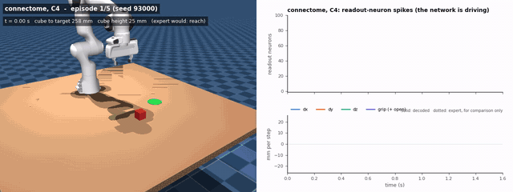
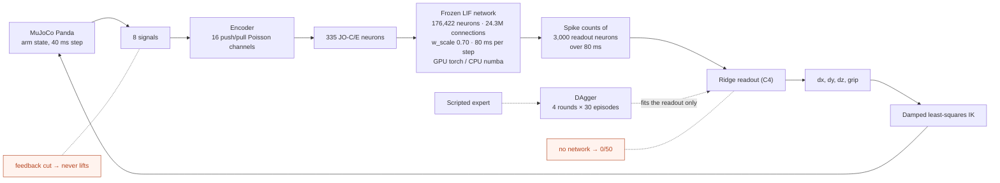

# A fly's brain drives a robot arm

**A frozen spiking model of the entire male *Drosophila* CNS controls a simulated Franka Panda
through pick-and-place, and degree-matched random wiring does just as well.**



The network is the FlyEM male CNS v1.0 connectome as a leaky integrate-and-fire model (176,422
neurons, 24.3M connections, Shiu et al. 2024 style). It is never trained. The arm's state goes in
through 335 antennal mechanosensory neurons, and a linear readout of 3,000 neurons, trained by
imitation (DAgger), drives the arm. On 50 fresh test seeds it completes **46/50**. Four
degree-preserving random networks score **50, 49, 45 and 50** under a pre-registered test, so the
result is about the network's size, degrees, weights and E/I balance, **not** the fly's specific
wiring.

Full video (75 s, captioned): [`docs/media/demo.mp4`](docs/media/demo.mp4) · Write-up: [`WRITEUP.md`](WRITEUP.md)

## Results

Fresh seeds 93000–93049. DAgger 4 × 30 on training seeds 64000+, the same for every policy. Kaggle
Tesla T4, float32. Source: [`results/week10/`](results/week10/), [`results/week10b/`](results/week10b/).

| policy | success | placement (successes, median) | time (median) |
|---|---|---|---|
| expert (scripted teacher) | 50/50 | 2.6 mm | 1.84 s |
| **connectome + linear readout (C4)** | **46/50** (95% CI 81–97%) | 14.3 mm | 3.08 s |
| random network, seed 0 (w_scale 1.133) | 50/50 | 5.4 mm | 3.26 s |
| random network, seed 1 (1.057) | 49/50 | 10.8 mm | 3.24 s |
| random network, seed 2 (1.082) | 45/50 | 9.4 mm | 3.40 s |
| random network, seed 3 (1.082) | 50/50 | 6.0 mm | 3.12 s |
| no network: linear readout on the 8 signals (plain / C4 weights) | 0/50 / 0/50 | – | – |
| no network: MLP on the 8 signals | 50/50 | 2.6 mm | 1.84 s |
| no network: grip-gated linear (G) | 34/50 | 9.3 mm | 2.40 s |
| connectome, C6 (C4 + press weighting) | 0/50 (lifts 100%, carries 0%) | – | – |
| all five networks, feedback cut | 0/10 each (never lifted) | – | – |

**Wiring verdict** (rule fixed in week 7): pair the connectome with each random network by seed and
test the milestones (success → zone → lifted) with an exact McNemar test, p < 0.05. The connectome
is better than 0 of 4 random networks and worse than 0 of 4 (success p = 0.125, 0.375, 1, 0.125):
**no effect of the wiring shown**. On placement, 3 of the 4 random networks are significantly more
precise. The MLP and grip-gated readouts work without any network, which is why the brain is read
out linearly.

## How it works



(Also as an image: [`docs/architecture.svg`](docs/architecture.svg).)

## What this does and doesn't show

- **Shows:** a frozen spiking network with the fly brain's size, degree distribution, synaptic
  weights and E/I balance, read out linearly from 3,000 active neurons, can do pick-and-place. The
  network is needed: a linear map of its inputs fails (0/50), and with the feedback cut the arm never
  lifts the cube.
- **Doesn't show:** that the fly's *wiring* solves pick-and-place. Random rewiring that keeps every
  neuron's degrees, weights and signs does as well, and places more precisely.
- **Limits:** one model (uniform LIF, synapse counts as weights, no plasticity); the readout uses
  central neurons (a readout of only the descending neurons failed, 0/50); the readout imitates a
  scripted expert; four shuffles of one kind; simulation only, with fixed cube yaw; placement 3–5×
  worse than the expert. Details in [`WRITEUP.md`](WRITEUP.md).

## Quickstart (CPU, no connectome needed)

Smoke tests: every module imports; on a small network, the numba and torch engines give identical
spikes in float64; the scripted expert places the cube in the MuJoCo Panda scene. They take about
a minute. Tested on Ubuntu 22.04 (WSL) with Python 3.10:

```bash
git clone https://github.com/Notlord69/fly-connectome-arm.git
```

```bash
cd fly-connectome-arm
```

```bash
python3 -m venv .venv && source .venv/bin/activate
```

```bash
pip install -r requirements.txt && pip install -r requirements-gpu.txt --index-url https://download.pytorch.org/whl/cpu
```

```bash
pip install -e .
```

```bash
scripts/fetch_panda_model.sh
```

```bash
pytest
```

## Reproducing the full experiment

1. **Fetch the connectome** (a 1.1 GB download; ~1.3 GB on disk once built, or ~0.3 GB with `--delete-raw`). The neuron table and
   the descending-neuron shortlist come from neuPrint, which needs a free token: neuprint.janelia.org
   → Account → Auth token.

   ```bash
   export NEUPRINT_TOKEN=...   # never commit this
   ```

   ```bash
   python scripts/fetch_connectome.py
   ```

   This writes `data/weights_male-cns_v1.0/`, `data/shortlist_week1.csv` and the two run
   parameters. Set `FLYARM_DATA_DIR` to put the data elsewhere.
2. **Run on a GPU.** On Kaggle (Tesla T4, Internet on), upload `data/` as a dataset (only
   `weights_male-cns_v1.0/`, `shortlist_week1.csv`, `wsyn_choice.json` and `week7/` are needed) and attach it
   together with this repo (or let the setup cell clone it). Then run
   [`notebooks/12_week10_final.ipynb`](notebooks/12_week10_final.ipynb): no-brain controls,
   connectome C4, random network C4 and connectome C6, **~100 min**. Then run
   [`notebooks/13_week10b_shuffles.ipynb`](notebooks/13_week10b_shuffles.ipynb) with week 10's
   output attached: three more random networks and the final verdict, **~110 min**. Without
   week 9's DAgger data attached, week 10 retrains the connectome's C4 readout from scratch
   (~40 min more). On your own GPU machine, `scripts/run_final.sh` runs both notebooks.
3. **Expect close but not identical counts.** GPU float32 spikes are not bit-reproducible between
   runs (rates are).

Other scripts: `scripts/make_demo_video.sh` (the demo, cut from the recorded videos),
`scripts/render_demo_episode.py` (renders new clips from week 10's saved readout, such as a
feedback-cut episode; needs a GPU) and `scripts/make_architecture_diagram.py`.

## Repo layout

```
sim/                  the model and the experiment (package name kept from the runs; see below)
  lif.py              weight set, Shiu et al. LIF parameters, Brian2 reference network, shuffle
  lif_numba.py        numba CPU engine (spike-identical to Brian2 in float64)
  batch7.py           batched engines: torch (GPU) and numba; brain = engine + encoder + recording
  network7.py         degree-preserving random network, wiring-based encoder channels, stats
  interface.py        encoder (signals -> Poisson rates) and decoder windows
  readout.py          ridge, grouped cross-validation
  closed_loop.py      week 6 reaching loop (its ridge readout and Wilson CI are reused)
  pickplace.py        8 signals, episodes, batched rollouts, DAgger, evaluation, McNemar
  expert8.py, expert9.py   the scripted teachers (fix B is expert8)
  pool8.py            active-neuron readout pool
  week7.py ... week10b.py  each week's experiment: readout recipes (C4, C6, G), runs, verdicts
  video7.py           episode video renderer (arm + spikes + decoded vs expert actions)
  config.py           DATA_DIR / MENAGERIE_DIR (env: FLYARM_DATA_DIR, FLYARM_MENAGERIE)
arm/                  panda_env.py (MuJoCo scene, IK, success test), expert.py (week 4 expert)
scripts/              data fetch, Panda fetch, final run, demo video, diagram, demo-episode render
notebooks/            the final notebooks (weeks 10 and 10b), outputs cleared
results/              every week's small results files (JSON/CSV) and figures
docs/                 architecture diagram, demo media, history.md, the weekly write-ups
tests/                smoke tests
archive/              earlier code and notebooks (weeks 1-9), kept for the record, not imported
```

The modules keep the names they had during the experiments (`sim.*`, `panda_env`, `expert`)
instead of being reorganised into a new package. The saved run files (`.pkl`) store the trained
readouts under those module names. The week 10 and 10b notebooks load week 9's and week 10's
saved runs, so renaming would break reproducing from them. [`docs/history.md`](docs/history.md)
has the week-by-week path from week 1 to 10b.

## Data and credits

- **Connectome:** FlyEM male CNS v1.0, HHMI Janelia FlyEM with the University of Cambridge, the
  MRC Laboratory of Molecular Biology and Google Research. Licensed
  [CC-BY 4.0](https://creativecommons.org/licenses/by/4.0/). https://male-cns.janelia.org ·
  neuPrint `male-cns:v1.0`. It is not redistributed here. The changes made (synapse counts as
  weights, signs from predicted transmitters, uniform LIF parameters) are listed in
  [`ATTRIBUTION.md`](ATTRIBUTION.md). No endorsement is implied.
- **Neuron model:** Shiu et al. (2024), "A *Drosophila* computational brain model reveals
  sensorimotor processing", *Nature* 634, 210–219.
- **Robot:** MuJoCo and the MuJoCo Menagerie Franka Emika Panda model (both Apache-2.0), fetched by
  script.
- Full citations and software credits: [`ATTRIBUTION.md`](ATTRIBUTION.md). To cite this repo:
  [`CITATION.cff`](CITATION.cff).

## Licence

Code: [MIT](LICENSE), © 2026 Notlord69. The licence covers this repository's code only. The connectome data
(CC-BY 4.0) and the Panda model (Apache-2.0) keep their own licences.
